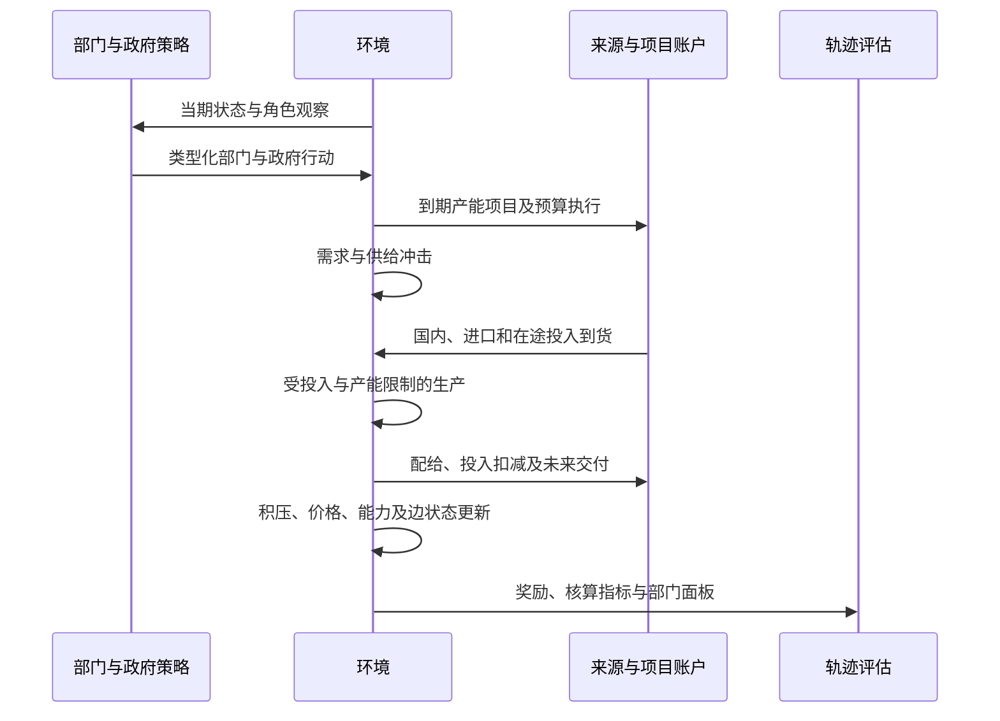

# IC-EconGym: An Input–Output-Constrained Multi-Agent Testbed for Semiconductor Industrial Policy and Supply-Chain Resilience

**中文题名：** IC-EconGym：投入产出约束下的集成电路产业政策与供应链韧性多智能体测试平台

**数据版本说明（2026-10-26）：** 结构与动态基准均采用附件三期 57 部门投入产出表中的 15 个相关部门；动态实验取 2020 年表。进口用途、AI 代理扩展与行为参数属于明示情景。

## 摘要

本文将附件 2020 年 57 部门投入产出矩阵中的 15 个集成电路相关部门接入 IC-EconGym 动态环境，另保留 42 个外部国内部门、进口和最终需求边界，并用 2018、2023 年同口径表核对结构变化。竞争型表不观测进口的逐用途去向，故设置三种守恒的分配情景。平台提供赋能、风险和治理三组共 15 项任务，以共同外生最终需求衡量履约。实验包括 870 条任务诊断轨迹、20 个独立学习训练实例、6,000 条锁定测试轨迹、23,400 条联合参数与配给评估，以及 600 条机制扫描。R1 部门 IPPO 在同分布测试的履约率为 55.86%，低于规则的 98.90%；G5 政府 PPO 相对均匀配置的配对差异接近零，重采样区间跨零。库存平滑相对既定规则的排序随配给制度变化。独立制造容量案例只检验项目队列的局部物理规则；460 节点企业披露网络只检验关系结构，未进入部门生产转移。结果证明环境能执行并审计条件机制比较，但细分部门、进口去向、AI 代理及行为系数均不足以支持现实政策因果推断。

**关键词：** 多智能体测试平台；投入产出约束；集成电路相关产业；供应链韧性；产业政策；机制诊断

## 1 Introduction

经济智能体的行动不能仅通过奖励函数中的加分项表示。扩产需要占用资源并等待投产，库存支持需要形成可用投入，部门产出还可能受到某一种上游产品限制。若这些约束没有进入环境转移，局部策略的高收益无法说明其提高了系统交付。对于集成电路相关产业，这一问题尤其突出：设计、制造、材料、设备与应用之间存在多种依赖，但宏观统计部门与工艺环节并非一一对应；部门总量、企业关系和产品交易额也具有不同的证据含义。

半导体行业的这一特征已有产业证据。OECD 的价值链研究把设计、制造、设备、材料和终端应用的联系置于全球专业化分工中；SIA 与 BCG 的行业报告同时讨论专业化的效率来源和关键环节集中带来的脆弱性 [1, 2]。美国商务部对 2021 年短缺的自愿调查还记录了重点芯片需求增长、买方库存下降与晶圆产能瓶颈并存的现象 [3]。这些资料说明需求、可用投入与产能需要共同建模，但其行业粒度、地域和计量单位不能直接移植到中国广义统计部门。

生产网络理论说明，部门特有冲击可以经直接与间接投入联系形成总体波动 [4]。动态投入产出模型进一步把需求、供给和库存纳入非均衡生产过程，并检验了冲击传播的预测能力 [5]。与此同时，EconGym 将多类经济角色与可替换策略组织为统一测试环境，以算法基准、现实贴合和运行效率支撑其平台主张 [6]。这两条研究路径为产业智能体实验提供了基础，但尚不能直接把通用家庭、银行或政府策略移植到具有分来源投入约束的产业部门，也不能把部门表直接解释为企业交易网络。

AI 赋能和产业政策也需要区分投入与已实现效果。吸收能力研究强调组织识别、吸收并应用外部知识的条件，技术—组织互补研究则说明技术投资需要配套资产 [7, 8, 9]。任务层效率向总量效应的转化还依赖受影响活动的覆盖范围 [10]。对于政策，近期产业政策综述强调测量、因果识别、实施治理和具体经济结构 [11]。因此，本文关注能力、订单与财政行动经过约束后产生的交付，而将现实政策有效性留给额外的行为识别与外部验证。

IC-EconGym 将部门核算结构转化为策略可作用的逐期环境。15 个相关部门分别提出生产计划、补库目标、价格调整和能力投入；政府在一次性总预算内选择支出渠道与部门配置。环境决定哪些计划能够生产、哪些交付可以到达，以及哪些项目只能在后续期生效。策略与经济结算分别实现，因而可在保持核算来源和观察权限一致的条件下替换策略、改变冲击和关闭机制。

本文围绕以下研究问题开展实验。

- **RQ1，能力转化的约束条件。** 相同 AI 支出下，提高吸收能力何时改善最终交付，何时仅改变能力状态？
- **RQ2，策略响应与系统交付。** 需求跟随、补库和供给通道选择如何改变内部订单，以及共同外生最终需求的履约？
- **RQ3，有限预算的配置效果。** 均匀、后向关联度和短缺靶向在相同财政资源下产生多大差异，该差异是否依赖机制和进口用途分配？

- **RQ4，学习目标与验证范围。** 学习奖励提高能否改善固定价格增加值与最终交付，局部容量规则在独立数据上的误差是否优于简单基线？

这些问题的共同要求是将“行动改变了状态”与“行动改善了交付”分开检验。平台据此提供三项贡献。**第一，分来源的可执行投入约束。** 国内、进口和其他国内部门边界分别形成可用投入，生产、交付、项目投产与财政行动处于统一时序。**第二，可组合的任务与策略接口。** 同一结算引擎支持 15 项任务及类型化部门、政府行动，参数和机制开关保存在可追踪配置中。**第三，面向内生订单与非绑定机制的评估协议。** 平台以共同最终需求计量履约，结合配对冲击、成本报告和机制关闭实验，识别策略差异的条件及无效干预。

本文研究对象是集成电路相关部门的条件机制实验。2020 年核算表提供基期用途和投入比例，细分结构包含收入分劈假设。本文将任务诊断、学习策略比较、制造容量外部案例、联合稳健性与运行性能组织为相互关联的证据。AI 工作簿用于构造异质性代理；其指标没有识别投入转化函数，全国模型的投资、库存和合同系数仍属情景值。模型内比较不解释为现实政策因果效应。

## 2 Related Work and Positioning

### 2.1 经济策略学习与测试平台

AI Economist 通过经济主体与规划者的两层深度多智能体强化学习研究税收设计，表明政策比较需要考虑主体对政策的响应 [12]。EconGym 进一步组织多角色和多任务，比较规则、学习及语言模型等策略，并考察跨政策协同 [6]。IC-EconGym 借鉴其角色、观察、行动、奖励和环境结算的分离方式，新增的研究对象是受投入来源、库存与产能约束的产业部门。原平台已训练的家庭或银行策略不构成本文部门基线；所有候选策略都必须适配本文的观察字段和行动结构。

新增算法实验使用 PPO 更新 [13]，分别训练 R1 部门参数共享 IPPO 和 G5 政府 PPO，并与合法随机、固定规则及单期代理优化比较。学习训练、验证和测试情景分别生成，保存训练实例、检查点和资源记录；实验设计参照强化学习经验研究对统计单位、预算与超参数报告的要求 [14]。该比较只覆盖两个任务，未进行语言模型调用、部门与政府联合学习或博弈均衡求解。规则策略的固定公式响应仍与学习策略区分。

这一实现属于计算经济学的规则主体路径。Tesfatsion 将经济过程表示为主体反复交互的动态系统，主体可以包含行为规则、属性与制度约束 [15]；Littman 的多主体框架则明确联合行动如何进入环境状态转移 [16]。本文沿用主体—行动—转移的组织方式，观察受角色权限限制，但不据此宣称已经求得博弈均衡或学习到经济行为。

### 2.2 投入产出结构与供应网络仿真

Acemoglu 等说明高阶投入依赖在部门冲击向总量波动的传导中具有重要作用 [4]。Pichler 等以动态投入产出模型表示行业供需冲击、库存和生产限制，并使用独立经济活动数据检验预测 [5]。本文沿用固定投入与库存约束的建模思路，重点提供策略接口、共同预算比较和机制诊断；没有完成与其同等的历史预测验证。

固定投入系数与 Leontief 关联分析提供了部门核算基础 [17]。Hallegatte 的 ARIO 模型进一步把产能和前后向传播用于灾害损失分析，说明重建需求只有经过产能约束才能转化为生产 [18]。Carvalho 等利用东日本大地震及企业关系数据识别了上下游冲击传播 [19]。这些研究支持在环境中保留投入依赖与产能，但理论网络、统计部门网络和观测企业网络分别支持不同层级的结论。

企业级供应链模型依赖更细的关系资料。Inoue 和 Todo 使用日本企业供应关系构建动态 ABM，并结合销售额与投入产出表推估交易权重 [20]。关系观测与交易额识别在该研究中也需区分。本项目现有 460 节点供应网络的核实版本，跨公告年并集包含 617 条披露交易关系；纳入其他来源后的并集为 768 条。关系矩阵记录的是可追溯的供需方向，跨年并集并非同一时点的完整生产网络；披露金额也不能直接充当逐产品投入系数。这套企业网络尚未与 2020 年 15 部门核算矩阵完成业务份额、产品、年份和守恒流量映射，因此未载入当前生产转移。三个合成供给通道仍只用于集中与拥堵实验。

库存与信息反馈属于另一层行为机制。Clark 和 Scarf 的多级库存研究表明，上游库存和交付提前期需要联动 [21]；Sterman 的实验研究讨论决策者对库存与反馈的误判 [22]；Lee 等将订单信息失真与终端销售区分，并分析牛鞭效应的多种来源 [23]。本文用这些研究解释补库和订单反馈的建模理由，具体系数仍由任务设定，且不把最终短缺变化直接称为牛鞭效应。

### 2.3 经济世界模型的系统边界

Han 等提出经济世界模型的能力阶梯与实现协议，将主体、环境、共演化、现实对齐和评估分开，并区分信念更新、行动、状态转移、聚合和制度演化 [24]。该文当前为 arXiv 预印本，本文借鉴的是其系统分类与诊断原则。IC-EconGym 已实现规则与离线训练策略的替换、环境执行和只读轨迹评价；未实现显式信念更新、持续在线学习、制度内生演化或在线数据纠正。政府在预算内选择支出属于行动，不构成制度自演化。

**表 1 系统定位与证据边界**

| 研究 | 核心对象 | 与本文相关的能力 | 本文采用或尚缺的部分 |
|---|---|---|---|
| EconGym [6] | 多角色经济任务与算法 | 模块化角色、跨任务策略比较、外部贴合及效率 | 采用接口组织；产业策略需重新实现 |
| AI Economist [12] | 主体与规划者共同学习 | 政策—主体响应及训练评估 | 已分别训练部门与政府；未共同训练两层策略 |
| 动态投入产出模型 [5] | 部门供需与库存传播 | 受投入约束的动态生产、独立预测检验 | 局部容量条件回放已检验；未完成全国动态预测检验 |
| 企业供应网络 ABM [20] | 实际企业关系与传播 | 库存、替代与细粒度关系 | 当前仅部门级，候选企业边不等于实际关系 |
| EWM 系统蓝图 [24] | 能力阶梯与实现协议 | 类型化接口及分层诊断 | 已实现执行、离线学习与局部对照；未实现共演化 |

模型报告参照 ODD 对实体、状态、时序、初始化、输入和子模型的要求 [25]，完整代码映射见附录 B。ODD 是描述与复现规范，不构成经济准确性的验证。

### 2.4 技术吸收、投资时滞与产业政策

Cohen 和 Levinthal 将吸收能力与既有知识及研发联系起来 [7]。Brynjolfsson 等关于组织资本和生产率 J 曲线的研究说明，通用技术的收益可能依赖互补投入与测量时序 [8, 9]。生成式 AI 的客服实证进一步发现，效果在经验和技能维度上具有异质性 [26]。本文据此区分采用存量、有效 AI 和交付绩效；部门级乘法转化式并非上述企业或劳动者研究估计出的函数。

Kydland 和 Prescott 的 time-to-build 研究为资本支出与可用生产资本之间的跨期分离提供了经典依据 [27]。Dosi 等在经济 ABM 中组织需求、创新、投资与政策反馈 [28]，Juhász 等则将产业政策的工具、实施与识别置于具体结构中讨论 [11]。本平台将投产队列与政府支出接口显式化，用于条件反事实；其财政权重和投产效率没有继承文献的经验估计。

### 2.5 产业粒度与模型验证

OECD 的半导体脆弱性研究指出，投入产出记录需要配合更细行业资料才能识别关键联系；设备资本购置也不能仅由中间使用矩阵表达 [29]。其晶圆产能研究按工艺、节点及经营模式区分产能与替代限制 [30]。这些分类为未来细化 H 机制提供方向，当前广义部门与合成通道仍保留自身统计边界。

验证方法同样需要分层。Sargent 区分概念模型、代码、运行结果与数据的有效性 [31]；Fagiolo 等讨论经济 ABM 中校准、经验事实与验证程序的关系 [32]。据此，本文分别报告核算与代码检查、模型内机制实验和独立制造容量案例。外部案例检验局部函数在物理单位上的误差，不以文献中的现实证据替代本环境的独立检验。

## 3 Data and Economic Boundary

### 3.1 部门划分与计量单位

动态基准取附件 2020 年“完表”的 57 部门竞争型投入产出矩阵。前 15 个集成电路相关部门是决策主体，其余 42 个部门为外部国内供给与需求边界；2018 年和 2023 年同口径表用于结构比较。15 个部门由 7 个设计与关键投入、2 个芯片制造与封测、6 个系统集成与终端应用部门组成，标签见附录 A。它们仍是统计部门，不是分别观测的企业或芯片工艺产线。尤其第 8、9 部门的制造与封测名称不能提供 H3、H4、H5 各环节的独立交易额。

金额单位为万元。令 $x_j$ 为年度基期产出，季度基准为 $q_j^0=x_j/4$。模型中的生产与投入按 2020 年表内现价金额作为基期产出当量，不是晶圆片数、芯片颗数或物理产线吞吐。年度转季度采用四个等长期间，没有估计季节性。价格状态用于收益和价格诊断，未用于重新估计投入系数。

### 3.2 国内与进口投入

记国内和进口中间使用为 $z^d_{rj}$、$z^m_{rj}$，国内最终使用为 $y^d_{rc}$，其中 $r=1,\ldots,57$、$j=1,\ldots,15$。固定投入系数为

\[
a^d_{rj}=\frac{z^d_{rj}}{x_j},\qquad a^m_{rj}=\frac{z^m_{rj}}{x_j}.
\tag{1}
\]

15 部门向其余国内部门销售的季度基准为 $X_r^0=\sum_{j=16}^{57}z^d_{rj}/4$，最终需求基准为 $F_r^0=\sum_c y^d_{rc}/4$。因此研究部门的基期产品用途满足

\[
q_r^0=\sum_{j=1}^{15}\frac{z^d_{rj}}4+X_r^0+F_r^0,
\qquad
x_j=\sum_{r=1}^{57}(z^d_{rj}+z^m_{rj})+VA_j^0.
\tag{2}
\]

现有资料没有识别每种进口产品的实际使用者。平台提供比例分配、优先中间使用、优先最终使用三种平衡假设，均保持核算总量并不将进口配置给出口用途。不同假设改变国内与进口来源约束，不能称为三套观测供应链。三期来源矩阵及进口分配后的最大绝对核算残差均小于 $1.75\times10^{-5}$ 万元；数值平衡反映构造一致性，不是预测精度。

式（1）—（2）的系数和用途核算采用投入产出分析的通常定义 [17]。收入分劈与进口使用分配属于本文数据处理选择。对于专用设备，资本形成中的新设备购置及其产能服务还需独立投资资料，不能仅凭设备部门的中间投入边推断完整扩产关系 [29]。

### 3.3 数据、参数与证据来源

**表 2 核算信息与情景信息**

| 信息 | 当前来源 | 模型中的用途 | 识别边界 |
|---|---|---|---|
| 年产出、投入、增加值 | 2018／2020／2023 年“完表”，动态基准取 2020 年 | 季度基准、固定投入系数 | 细分结构含研究者分劈，不是逐笔观测 |
| 进口用途 | 三种平衡分配 | 分来源生产约束 | 进口实际使用者未知 |
| AI 初值与吸收异质性 | 文本／专利部门代理及情景缩放 | G5 与机制扫描的条件初值 | 混合年份、粗映射；不是真实 2020 年状态 |
| AI 转化、预测、投资、积压、交付系数 | YAML 与代码设定 | 跨期状态转移 | 未由投入产出表估计 |
| 企业物理容量与资本支出 | 官方季度公告 | 局部容量队列的外部检验 | 不直接校准全国价值量系数 |
| 460 节点披露关系网络 | 项目企业资料 | 未来企业级扩展的证据支持集 | 未识别可守恒映射的 2020 年逐产品业务份额 |
| 政府目标与权重 | 任务配置 | 支出和奖励 | 非经验社会福利函数 |

三期 57 部门矩阵、15 部门标签及来源哈希在工作区分别留档；动态输入由三种进口用途情景生成。来源工作簿和逐部门派生矩阵尚未获公开再分发许可，复现完整数据预处理仍需取得原始附件。

### 3.4 参数设定依据与识别状态

本文分别记录核算量、理论支持的机制形式、任务情景参数与数值实现设置。文献使规则的选择理由可追踪；具体系数只有经过与研究对象相符的估计才能称为经验参数。模型验证研究也要求把参数校准与结果检验分开 [31, 32]。表 P1—P2 列出正文主要参数；完整配置保留在 YAML 和实验元数据中，任务覆盖值优先于代码默认值。

**表 P1 核算、能力与资源参数**

| 参数组 | 当前数值／定义 | 文献依据与参数身份 |
|---|---|---|
| 核算与期间 | $a^d=z^d/x$、$a^m=z^m/x$；年度流量除以 4 | [17] 支持核算定义；四等分是无季节性转换约定 |
| 基期初始化 | 产能与产出为 $q^0$；成品与材料初值 0；一期内部在途为基期流量 | ODD 要求报告初始化 [25]；此处是工程设定，不代表实测库存 |
| 吸收与摩擦 | 角色吸收 0.50—0.65、摩擦 0.09—0.14；时间适配 0.9；E1 吸收 0.2／0.9 | [7, 8] 支持互补和异质性；函数与数值均为情景设定 |
| AI 转化与产能 | 转化默认 0.1；生产率增益默认 0.1、E1 为 0.3；E1 支出率 0.02 | [9] 支持采用与实现效果分离；数值未估计 |
| 研发与技术 | 转化默认 0.01、折旧 0.001、AI 互补 0.5；E3 转化 0.1、折旧 0.00001 | [7, 28] 为研发和能力积累背景；默认与任务覆盖值分别报告 |
| 补库与积压 | 补库速度 0.25；平滑策略目标 0.25 季度；积压保留 0.25、上限 2 季度 | [21, 22] 支持库存反馈；不是最优库存或实测取消率 |
| 外部来源上限 | 计划到货上限为基期投入的 1.25 倍 | [5] 与 [18, 29] 支持供给约束；1.25 未由统计表识别 |
| 资本项目 | 私人／政府默认转化 0.1；默认滞后 4 季度；R1 为 6，对照为 2／10 | [27, 30] 支持跨期形成；固定滞后与效率不是文献估计 |

**表 P2 选择、治理与实验参数**

| 参数组 | 当前数值／定义 | 文献依据与参数身份 |
|---|---|---|
| 供给通道 | 3 槽；质量 1／0.9／0.8；偏置 0／0.03／0.05；容量份额 0.45／0.40／0.35；R4 精度 0／5／12、容量乘子 1.05 | [33, 34] 支持 Logit 形式；槽、容量和效用均为合成设定 |
| 预测误差 | E2 标准差 0.12、AI 降误差系数 0.6；R3 标准差 0.2、共同载荷 0／0.5／0.95 | [22, 23] 提供信息反馈背景；高斯过程及系数为情景值 |
| 边与资格 | 压力记忆 0.70；健康下限 0.85；资格初始为 1，内部运输基准 1 季度 | [20] 与 [19] 支持传播动机；式（B3）系数与资格规则由本文设定 |
| 价格与成本 | 自动调价系数 0.05，单步项截断 ±0.05；动作项截断 ±0.1；劳动其他成本份额 0.8 | [28] 为 ABM 定价背景；本缺口式调价及份额未经验校准 |
| 合同与协同 | G3 核验强度 0.1／0.5／0.9；惩罚 0.2；剩余权重 0.5；份额网格 101 点 | [34, 35] 支持目标与选择形式；强度、系数及网格属于情景／数值设置 |
| 努力配置 | 5 种努力、上限 1；成本系数为 1；预算默认 1 | [36] 支持优化条件；收益权重与预算由本文设定 |
| 财政与冲击 | G5 初始预算为季度基准总产出的 1%；每期花费余款 0.25；产能损失 0.2；R1 需求增量 0.3 | [11] 支持条件化政策评价；该数值非现实财政占比或实测冲击 |
| 实验与扰动 | 30 季度；10 个匹配种子；冲击离散标准差 0.04；名义 OFAT ±20% | [32, 37] 支持报告不确定性；期间和范围是实验设计，非置信区间 |

上述文献未提供本稿的吸收率、扩产速度、取消率、槽容量或财政权重。它们用于构造可比较条件，不承担中国集成电路产业的点预测。原对照任务和单因素扰动保留；新增联合采样及替代配给实验见第 6.10 节。联合区间用于探索，不具有经验分布含义，参数范围的产业数据依据仍需补充。将 OAT／OFAT 当作全局敏感性证据会遗漏交互方向 [37]。


### 3.5 部门分劈的方法证据与不确定性

附件投入产出研究稿 [38] 说明，其资料采用 2018、2020、2023 年 42 部门非竞争型投入产出表，合并国产和进口使用后构建竞争型结构。相关行业与母部门同口径规模以上营业收入之比作为分离系数。同一比例转换用于行和列；若定义 $T$ 为新部门对原部门的分配矩阵，则 $Z^{new}=TZ^{old}T^\top$，产出和最终需求按相应方向转换。该操作以收入份额近似投入与销往构成，并不观测细类行业逐笔交易。

稿件列示 2019／2021 年《中国工业统计年鉴》、2023 年《中国经济普查年鉴》，辅以 2018 年《中国经济普查年鉴》和 2019／2021 年《中国统计年鉴》。此处记录附件所述版本，未取得各项原表页与单元格，不能据此确认每个收入分子、分母。四位数行业缺失时，稿件允许使用覆盖一致的三位数行业；仅 2020 年缺失时以 2018 和 2023 年插值，三期均缺失则不纳入。使用 2023 年信息补 2020 年结构属于事后构造，不能用作当时可获信息的预测实验。

最新三张工作簿的“完表”均含 57 个部门，其中 F—T 列及第 5—19 行构成 15 个集成电路相关部门，其余 42 个部门保留为外部统计边界。15 个部门分为设计与关键投入 7 个、芯片制造与封测 2 个、系统集成与终端应用 6 个。与旧版 13 部门相比，新表单列信息传输、软件和信息技术服务的制造与封测环节（第 9 部门）及系统集成与终端应用环节（第 15 部门）。原 13 部门仅能按母部门作位置对应，金额和技术系数不能沿用。本轮已按三张表的已保存数值重建 15×15 中间使用、直接投入系数、57 部门边界、产出、增加值、进口和最终使用，并校验行列恒等式；输出与来源哈希见工作区 `outputs/io_15_2018_2020_2023/`。

三张“完表”合并国内与进口使用，不能直接识别每个使用者的进口份额。动态版本按可分配用途比例、中间使用优先、最终使用优先三种规则逐产品分配进口；出口不分配进口，负存货变动视为库存提取。每种规则都核对进口行和国内产出行守恒，分配结果仍是情景假设。2020 年的三种派生矩阵接入 15 部门动态环境；任务配置、角色、AI 功能代理、学习动作维度均据新表重建。2018、2023 年矩阵保留用于结构比较，未将名义差额作为动态增长参数。

### 3.6 AI 代理聚合及其参数身份

AI 工作簿 [39] 包含四类资料：2024 年职业构成加权任务暴露、2024 年招聘渗透、2023 年年报文本强度，以及未注明年份的专利与收入记录。有效指标记录分别为 1,426、261、1,416 和 126 条。任务暴露存在负值，文本采用 $\log(1+\text{AI词频})$；专利代理在本轮定义为 $\log[1+\text{引用专利数}/(\text{营业收入}/10^8)]$。这些指标没有共同年度的纵向配对，不宜相加后解释为一项已校准综合指数。

按可用环节标签作功能映射：设备 H1 对应部门 4／5／7，材料 H2 对应 1／2／3／6，H3／H4／H5 合并对应部门 8／9，应用 H6 对应 10—15。新增第 9、15 部门沿用相应功能组代理，未获得独立行业测量。部门均值采用有效企业记录的算术平均；合并 H3／H4／H5 时先合并企业记录再求均值，样本较多的环节因而获得更大权重。各指标分别记录有效样本数，缺失不补零；H5 专利记录缺失，合并均值不能补足这一缺口。多个统计部门共享同一环节代理，是行业代码和多业务归属不足时的粗映射。

令 $\bar m_j$ 为部门代理均值，定义相对分数 $s_j=(\bar m_j-\min_\ell\bar m_\ell)/(\max_\ell\bar m_\ell-\min_\ell\bar m_\ell)$。本轮将文本分数用于 $AI_{j,0}=0.2s_j^{text}$，将专利分数用于 $\eta_j=0.3+0.4s_j^{patent}$。最低分为零只表示样本内相对位置，不表示实际没有 AI 采用；0.2 和 0.3—0.7 仍是情景缩放。招聘和暴露指标分别保留，没有用于改写投入转换系数。

因此，均值可提供采用或知识吸收的相对代理，并用于异质性情景；它不能直接替换 AI 投入转化效率，也没有识别结构性吸收参数。G5 和新增机制扫描采用此代理初值，R1 保留无 AI 的原机制。2023／2024／未注明年份的代理与 2020 年结构结合，解释为给定核算结构下的数据辅助情景，不是观测的 2020 年初始经济。代理映射遵循采用与实现效果的区分 [7, 8]，其有效性仍需同年投入、采用、互补资本和产出数据检验。

### 3.7 外部观测、校准与留出期

独立制造案例采用中芯国际官方 2020Q1—2025Q4 共 24 份季度业绩公告 [40]。提取月产能、资本支出、利用率与出货量，保存公告 URL、PDF 哈希、页码与数值所在片段。校准和留出模型仅使用容量与资本支出；利用率及出货量用于保留观测背景，没有强制换算成不存在的全国 15 部门金额序列。

容量计量为月度标准逻辑 8 英寸晶圆当量，资本支出为百万美元。容量队列使用与全国模型共用的排程函数，期数映射为季度；其物理转换效率不直接移植为全国固定价格产出当量的资本效率。以 2020Q4 容量初始化、2020 年资本支出提供队列前史，2021Q1—2022Q4 校准效率，2023 年从 1—4 季度滞后候选中选择，2024Q1—2025Q4 留出检验。

已知历史资本支出作为输入强制量，因而该实验是条件回放，不是无未来投入信息的事前预测。外部容量检查覆盖局部投产规则，未识别全国部门的 AI、库存、合同、融资或需求反应。原始公告按官方链接获取，公共仓库保留可复核提取表和来源清单。

**数据与参数清单。** 新增 [数据来源](../calibration/data_source_registry.csv)、[分劈清单](../calibration/sector_split_registry.csv)、[动态配置与参数清单](../calibration/dynamic_parameter_registry.csv) 和 [AI 代理说明](../calibration/README.md)。动态清单共 78 条配置项、参数和硬编码规则，包含身份、代码位置及依据缺口；这一数量不是 78 项已估计的经济参数。

## 4 IC-EconGym Environment

### 4.1 决策主体与环境状态

令主体集合为 $\mathcal N=\{1,\ldots,15,g\}$，任务 $\tau$ 声明机制、冲击、观察、策略和有限期间 $H$。全环境状态包含部门产出与产能、分来源投入库存、成品库存、积压、价格、AI 与技术存量、边压力与资格、在途交付队列、待投产项目、剩余财政预算和时期。对合法行动，转移写为

\[
o_{i,t}=\mathcal O_i(s_t),\quad a_{i,t}=\pi_i(o_{i,t}),\quad
s_{t+1}=T_\tau(s_t,a_{1:15,t},a_{g,t},u_t;A^d,A^m).
\tag{3}
\]

这里 $u_t$ 是声明的外生需求或供给冲击。完整状态包含在途与项目队列；仅给出当期产出向量不足以定义下一期。当前策略系数在一次运行内固定，环境状态演化不被称为策略学习。

式（3）采用交互主体与联合行动的环境表述 [15, 16]。状态和观察分别定义，使部门能够按局部信息决策，而在途投入、财政和项目仍由环境执行。实体、状态、初始化与调度遵循 ODD 的报告要求 [25]；这些接口定义并不保证局部观察构成马尔可夫充分统计量。

**表 3 主体接口与可行域**

| 主体 | 可观察信息 | 类型化行动 | 约束与奖励 |
|---|---|---|---|
| 部门 $j$ | 自身产出、基准、产能、成品库存、积压、价格、AI、有效 AI、技术、吸收；相连部门编号、上游价格与健康；上一期总需求、政府剩余预算 | 生产计划、内部投入补库目标、价格调整、资本／研发／AI 支出份额、协同、多元化 | 有限数值、非负份额、角色权限；经营现金流式奖励 |
| 政府 $g$ | 各部门产出、增加值、价格、短缺、积压、技术、有效 AI、关联度、边健康与财政预算 | 六类长度为 15 的非负支出向量 | 请求按剩余总预算缩放；配置权重下的系统奖励 |

部门观察不包含完整原料库存、在途队列或其他部门全部私人状态，`inventory` 指自身成品库存。角色表声明可用行动，但当前 15 个角色的控制字段相同，异质性主要来自投入位置、规模、吸收和摩擦。私人投入计入奖励和成本，没有由现金存量或融资约束形成的企业硬预算；银行、家庭和劳动力市场未单独建模。本文因而只主张投入用途、库存执行与政府预算约束，不主张全经济金融账户闭合。


图 1 平台决策主体、环境与显式边界。其他 42 个部门、进口和最终使用没有独立策略。

### 4.2 订单与分来源到货

环境将生产计划截断为 $\widehat q_{j,t}\in[0,2q_j^0]$。内部国内订单为

\[
O^d_{rj,t}=a^d_{rj}\widehat q_{j,t}
+\lambda_I\left[\iota_{j,t}z^d_{rj}/4-M^d_{rj,t}\right]_+,
\qquad r\leq15,
\tag{4}
\]

式（4）采用目标库存缺口的补库思想，与多级库存控制及库存调整启发式的机制背景相连 [21, 22]。本规则没有把全部在途量组成经典库存位置，也未求解最优目标。订单由计划与补库共同生成，因此需要与终端需求分别计量 [23]。

其中 $\iota_{j,t}$ 为补库目标的季度数，$\lambda_I$ 为补库调节系数。内部订单由行动生成。其他国内来源和进口每期按计划需求与基期外部供给上限的较小值到货；以进口为例，

\[
R^m_{rj,t}=\min\{a^m_{rj}\widehat q_{j,t},\ \epsilon_{ext}z^m_{rj}/4\}\,\chi_{rj,t}.
\tag{5}
\]

$\chi_{rj,t}$ 是外部投入冲击乘子，国内外部来源采用同类规则。二者单独入账，当前没有进口与国产的自动替代。政府库存支持在启用库存机制时从其他国内部门边界购买额外投入；这会改变可用资源，不是最终交付上的直接加成。

### 4.3 生产与配给

令当期销售请求为 $D_{r,t}=\sum_j O^d_{rj,t}+X_r^0+F_{r,t}+b_{r,t}$，$b_{r,t}$ 为期初积压。有效产能综合冲击、AI、技术及启用的制造约束。生产执行

\[
q_{j,t}=\left[\min\left\{
\widehat q_{j,t}+b_{j,t},D_{j,t},K^{eff}_{j,t},
\min_{r:a^d_{rj}>0}\frac{M^d_{rj,t}}{a^d_{rj}},
\min_{r:a^m_{rj}>0}\frac{M^m_{rj,t}}{a^m_{rj}}
\right\}\right]_+.
\tag{6}
\]

实现中小于或等于 $10^{-12}$ 的投入系数不构成瓶颈上界；生产后按固定投入系数扣减材料。成品可用量为当期产出加期初成品库存。环境先满足内部投入订单，剩余按比例分配给其他国内部门、当期最终使用及旧积压。这一配给顺序是制度假设，不是由统计表估计的市场清算规则。没有最终使用者的价格弹性或效用最大化过程。

固定比例投入由 Leontief 技术提供核算基础 [17]，式（6）的需求、产能和库存共同限制与 ARIO 及动态投入产出模型的非均衡生产思路相连 [18] [5]。本文的中间品优先配给、来源分账和截断顺序按当前引擎定义，不能从经典投入产出系数推导出唯一配给制度。

未售出产品转成品库存。总未满足订单 $S_{r,t}$ 按设定保留率转积压：

\[
b_{r,t+1}=\min\{\rho_B S_{r,t},\ \overline b q_r^0\}.
\tag{7}
\]

积压未保留部门内中间、最终和旧订单的批次身份，因而不能计算逐客户等待时间或延迟交付满意度。内部已发运投入在至少一个季度后进入接收方材料库存；代码以发运量乘边健康 $h_{rj,t}$ 和资格 $\nu_{rj,t}$ 形成后续有效到货。两者在当前实现中是可用量折损系数，不是逐晶圆良率或失效事件的经验概率。折损没有另设物理废料账户，不宜把该过程称为逐物料完全守恒的物流系统。

### 4.4 能力、承接边与供给通道

有效 AI 为

\[
\alpha_{j,t}=\operatorname{clip}\left(
\frac{AI_{j,t}\,\eta_j\,\phi}{1+f_j},0,3\right),
\tag{8}
\]

其中 $\eta_j$ 为吸收能力，$\phi$ 为时间适配，$f_j$ 为组织摩擦。启用 AI 时，产能乘以 $1+\beta_{AI}\alpha_{j,t}$；AI 还可降低设定的劳动与其他成本，并提高研发转化系数。研发形成无量纲技术状态，技术产能增益只取超过基准 1 的正部分。采用、吸收、研发折旧与转化均为情景参数。

采用与吸收的分离借鉴吸收能力和组织资本研究 [7, 8]，互补投入和收益形成的跨期性可与生产率 J 曲线研究对话 [9]。式（8）的乘法与摩擦分母是本文的简化转化函数，未从这些论文的企业或劳动者估计中移植。

**命题 1，局部产能增益的条件。** 在给定期初材料、需求、计划、积压及其他机制状态的条件下，令 $L_{j,t}$ 为式（6）中除有效产能外各上界的最小值，且有效产能为 $K_{j,t}(1+\beta_{AI}\alpha_{j,t})$。则

\[
\frac{\partial q_{j,t}}{\partial\alpha_{j,t}}=
\begin{cases}
K_{j,t}\beta_{AI},&K_{j,t}(1+\beta_{AI}\alpha_{j,t})<L_{j,t},\\
0,&K_{j,t}(1+\beta_{AI}\alpha_{j,t})>L_{j,t}.
\end{cases}
\tag{9}
\]

相等处一般不可微。命题直接来自最小值约束，证明见附录 C；它是固定其他条件的局部性质，不保证多期网络中的总体收益或最优投资方向。E1 实验检验能力增益何时进入实际交付。

承接边压力由有效 AI 与下游吸收的正错配、订单—到货缺口、协同和修复共同更新，健康度经截断映射形成。该机制必须达到触发条件并改变后续生产约束，才能影响系统结果。资格初值为 1，当前规则仅增加并截断至 1；因此未附加资格退化的标准情景中，资格支持不存在改善空间。

启用供给选择时，产品来源部门内部设置三个合成通道。质量分值为 $(1,0.9,0.8)$，通道偏置为 $(0,0.03,0.05)$，选择权重与容量为

\[
p_{rc}=\frac{\exp(\kappa q_c-d_c)}{\sum_{c'}\exp(\kappa q_{c'}-d_{c'})},
\qquad
\mathcal K_{rc}=s_c\gamma\sum_j z^d_{rj}/4,
\tag{10}
\]

其中 $s=(0.45,0.40,0.35)$、$\kappa$ 为搜索精度、$\gamma$ 为通道容量乘子。通道需求超过容量后削减内部交付，HHI 为 $\sum_c p_{rc}^2$。这是一项受容量约束的选择机制，不是企业真实供应商识别、网络重连或最优采购模型。R4 用于检验集中与拥堵的条件关系。

式（10）的归一化指数形式借鉴条件 Logit [33, 34]。当前代码直接用权重分配订单，未估计效用系数或抽取真实企业选择。Logit 的替代结构与其选择集合有关，真实半导体设备和工艺是否可替代还需专门资料 [29, 30]。

### 4.5 投资、政府预算与奖励

私人资本、研发与 AI 支出为相应行动份额乘以 $q_j^0$。私人资本支出经过设定滞后转为产能，政府产能支出另进入项目队列。收益以价格加权交付为收入，扣除投入、设定的劳动其他成本、库存与总短缺代价；部门奖励再扣除当期私人能力投入。固定价格增加值为 $a_j^{VA}q_{j,t}$，并不因为 AI 降低设定成本而自动改变增加值系数。

将投资先记为项目、再形成可用产能，以 time-to-build 文献为机制依据 [27]。创新、计划、投资及定价的启发式组合可与经济 ABM 研究比较 [28]；本项目的线性转化、固定时滞与成本权重另行设定，并未继承其均衡或行为估计。

政府请求 $G_{jk,t}\geq0$ 经剩余预算 $\mathcal B_t$ 缩放为实际支出：

\[
g_{jk,t}=G_{jk,t}\min\left\{1,\frac{\mathcal B_t}{\sum_{j,k}G_{jk,t}}\right\},\quad
\mathcal B_{t+1}=\mathcal B_t-\sum_{j,k}g_{jk,t},
\tag{11}
\]

总请求为零时实际支出为零。对于有限非负请求，式（11）保证实际支出不超过预算。预算为整个运行的一次性总额，没有自动季度补充。六个渠道为 AI、产能、研发、资格、库存和边修复；支出是否改变产出还取决于对应机制和约束。政府奖励是配置权重下的增加值、技术、履约、价格波动、总短缺、财政与集中度的组合，不解释为已估计的社会福利。

协同模块将设定激励与短缺率映射为 Logit 协同概率，并使用受预算约束的二次目标分配五种努力。条件 Nash 式激励份额通过有限网格求得，用于协同概率；没有独立的平台智能体或相应现金转移账户。有关公式和局限见附录 B。

协同概率使用离散选择的 Logit 形式 [34]，双方非负剩余乘积借鉴 Nash 谈判目标 [35]，努力配置则采用可分离凹目标的 KKT 条件 [36]。它们为风格化规则提供形式依据，有限网格与激励映射不等于完整谈判均衡。政府目标和工具的经济解释参照产业政策评价中对具体约束与实施条件的强调 [11]。

### 4.6 更新时序与实现



图 2 合法行动下的季度更新顺序。动作的调用顺序与环境内生效顺序分别由策略接口和结算代码决定。

运行时提供 `reset / run_agents / step / evaluate`，任务配置和随机种子可追踪。该接口用于环境式执行，尚不宣称完全兼容 Gymnasium 或 PettingZoo。静态项目页面回放预计算轨迹，浏览器选择操作不重新运行模型。

固定调度、初始化和子模型顺序依据 ODD 报告 [25]；结算执行和独立评价的区分借鉴测试平台及系统蓝图 [6, 24]。代码与概念规则的一致性通过实现检查评价，现实适用性需要另行验证 [31]。


### 4.7 学习接口、可行动作与奖励审计

15 部门动态引擎以 `model_v4.py` 实现，记录生产计划、需求、产能、国内投入和进口投入五类上界及绑定状态，并保留到货、在途、项目、财政执行和逐期奖励。`reset / run_agents / step / evaluate` 适配层连接规则与学习策略；它不是完整的 Gymnasium 或 PettingZoo API。固定投入系数、进口用途分配和行为参数按版本留档，旧 13 部门实验不作为新引擎结果。

R1 的部门观察包含自身产出、产能、成品库存、积压、价格、上一期可见需求、AI、技术、上游均值及 15 维部门标识；G5 使用政府权限内的 15 部门状态和剩余预算。未来冲击和未来到货均不直接进入观察。R1 生产计划投影至 $[0.3q_j^0,2q_j^0]$，补库目标为 $[0,0.5]$ 季度，私人资本、研发和 AI 支出合计份额不超过 0.05。各策略的直接调价行动冻结为零，环境的缺口调价仍可变化。G5 输出 15 维非负且和为 1 的部门权重；渠道组合与每期请求剩余预算的 25% 在各策略间一致。

PPO 使用截断策略目标 [13]。R1 为共享参数、部门标识和本地价值函数的 IPPO，三个连续控制由 Beta 分布给出；G5 由 Dirichlet 分布分配部门权重。训练奖励分别为部门现金流除以本部门季度基准产出、政府福利除以 15 部门季度基准总产出。两种奖励的数值不可直接横比。审计同时报告最终需求履约、固定系数增加值、价格、私人投入与财政支出；训练奖励提高不自动表示这些指标改善。

替代配给实验另设按总需求比例和最终需求优先两种规则。它们改变内部投入循环与后续材料库存，属于机制设定的变化。

## 5 Benchmark Tasks and Evaluation Protocol

### 5.1 任务组合与可检验对象

15 项任务共享结算引擎，分别改变能力、风险或治理配置。任务名称声明研究意图，不意味着该机制已经触发或经经验验证。

**表 4 任务机制与评价对象**

| 任务 | 配置名称 | 机制 | 评价对象 |
|---|---|---|---|
| E1 | AI有效生产率 | 采用、吸收与产能增益 | 有效 AI、产能及最终履约 |
| E2 | AI预测与供应链协同 | 随机预测误差与订单响应 | 误差设定、订单、短缺 |
| E3 | AI与研发效率 | AI—研发转化互补 | 技术状态及交付转化 |
| E4 | AI与供应商匹配 | 合成通道偏好与容量 | HHI、拥堵及最终履约 |
| E5 | AI需求与产业结构 | 设定需求扩张与扩产 | 需求、产出、项目及短缺 |
| R1 | 需求扩张与产能周期 | 资本滞后与订单反馈 | 内部订单、产能及最终履约 |
| R2 | AI扩散与承接错配 | 能力—承接正错配 | 阈值、边压力及有效到货 |
| R3 | 共同预测误判 | 共同预测误差载荷 | 跨部门误差、订单及短缺 |
| R4 | 算法采购与供给集中 | 搜索集中与通道拥堵 | HHI、拥堵及最终履约 |
| R5 | AI异质性与市场势力 | 异质能力与 HHI 加价 | 能力、集中、价格及交付 |
| G1 | AI补贴配置 | AI 支持的部门配置 | 有效 AI、财政成本及交付 |
| G2 | AI与实体能力组合政策 | AI 与实体能力支出组合 | 投产、成本及最终履约 |
| G3 | 数字契约与可核验协同 | 条件合同与核验激励 | 协同强度及交付转化 |
| G4 | 库存认证与修复 | 库存、资格与边修复 | 资格、库存、到货及交付 |
| G5 | 多目标政策组合 | 渠道组合与部门靶向 | 共同预算、最终履约及成本 |

每题至少同时记录机制状态、最终需求交付、增加值及成本。E1、R1、R4、G5 作为正文案例，分别覆盖能力转化、订单反馈、供给拥堵和有限预算靶向。其他任务的配置和逐臂诊断见附录 D；未激活的机制作为诊断结果报告。

### 5.2 部门与政府基线

设 $d_{j,t}$ 为部门观察到的上一期总订单与基期产出的比。三种部门策略分别为

\[
\widehat q^R_{j,t}=q_j^0\operatorname{clip}(0.7+0.3d_{j,t},0.3,1.8),
\tag{12}
\]
\[
\widehat q^D_{j,t}=q_j^0\operatorname{clip}(d_{j,t},0.3,2),\qquad
\widehat q^S_{j,t}=q_j^0\operatorname{clip}(0.5+0.5d_{j,t},0.3,2).
\tag{13}
\]

库存平滑策略另设内部材料库存目标 0.25 个季度。三者使用相同观察结构，研发、AI 与资本行动沿用规则模块；补库与产量反馈造成的后续私人支出可能不同。比较保证相同接口和外生资源，不保证相同已实现私人投入，相关成本单列报告。它们是透明启发式，不是强化学习、最优控制或求解均衡的算法。

需求响应和库存调整作为基线，源自库存控制与行为反馈研究提供的可解释规则族 [21, 22]。式（12）—（13）的平滑权重由本文指定，未复刻文献的估计策略或最优控制器。关联度靶向使用经典后向联系的结构指标 [17]，加入短缺权重则是本平台的政策启发式。

令 $\ell_j$ 为完整 57 部门国内 Leontief 逆矩阵列和的标准化值。政府三种权重为

\[
w_j^U\propto1,\qquad w_j^L\propto\ell_j,\qquad
w_{j,t}^S\propto\ell_j\left(0.1+\frac{S_{j,t-1}}{\max(q_j^0,1)}\right).
\tag{14}
\]

三种政府策略共用支出渠道、起始期、总预算和每期剩余预算支出比例 0.25，仅替换部门靶向。短缺靶向使用总订单短缺作为可见状态；评价则独立使用最终需求履约，避免将策略自身的目标或中间量视为绩效。

### 5.3 内生订单与共同最终需求指标

订单与最终销售的区分可与订单信息失真研究相连 [23]。式（15）以本模型共同外生需求构造任务绩效；它不是文献牛鞭方差指标或现实社会福利度量。

总订单短缺混合了策略生成的内部需求、当期外部需求与旧积压。减少内部订单可能改变总短缺和总订单服务率的分母，因此仅凭其排序不足以比较相同最终使用需求下的服务能力。令 $C_{j,t}$ 为当期最终交付，主要指标为

\[
S^F=\sum_t\sum_j[F_{j,t}-C_{j,t}]_+,\qquad
\Phi^F=\frac{\sum_t\sum_jC_{j,t}}{\sum_t\sum_jF_{j,t}}.
\tag{15}
\]

同一配对情景中的 $F_{j,t}$ 对各策略相同。$\Phi^F$ 是需求加权的跨期当期履约率，不是逐期比例的平均，也不追踪旧最终订单的迟交。总订单短缺、固定价格增加值、价格、私人投入和财政支出作为辅助指标。对于相同情景 $c$ 与种子 $s$，政策比较报告

\[
\Delta\Phi^F_{c,s}(\pi,\pi_0)=\Phi^F_{c,s}(\pi)-\Phi^F_{c,s}(\pi_0).
\tag{16}
\]

先在相同冲击内计算差异，再汇总均值与范围。图表中的“百分点”均为比例差乘 100，不与百分比相对变化混用。种子分散来自设定冲击，不代表现实样本抽样，本文不据此作现实政策显著性推断。

### 5.4 实验矩阵与机制诊断

R1 在第 4—11 期对第 13 部门施加最终需求冲击，G5 在第 5—9 期降低第 8 部门产能。每条轨迹为 30 个季度，匹配种子为 42—51。冲击幅度乘以由种子生成的非负扰动，标准差系数 0.04；这是情景设计而非经验误差分布。三种进口分配与每题五项名义 ±20% 单因素扰动形成 13 个条件；两任务各 390 条策略轨迹，共 780 条。

E1 在同一 AI 支出下比较 0.2 和 0.9 的吸收设定：基期需求条件各运行一次，制造部门需求冲击条件使用 10 个配对种子，共 66 条轨迹。R1、G5 在三种进口分配下分别关闭边更新和私人资本投资，共 360 条轨迹；关闭私人投资时，政府资本渠道仍可执行。15 项任务的预设臂各用 10 个种子运行 30 期，共 870 条任务诊断轨迹。机制评价依次检查配置、状态、约束绑定和最终交付；同义臂及无随机机制的重复种子不作为独立机制证据。

### 5.5 新增实验包、锁定情景及统计单位

新增实验按任务诊断、算法基准、局部外部检验、联合稳健性和运行性能组织。学习比较限于 R1、G5。R1 比较既定规则、需求跟随、库存平滑、合法随机、单期代理优化及部门 IPPO；G5 比较均匀、关联度、短缺、合法随机、单期代理优化及政府 PPO。单期优化使用可见状态的局部代理目标，不能视为跨期全局最优。共同观察、行动区间、机制掩码与财政资源保持一致；私人实际支出由策略决定，单列报告。

每任务训练 10 个独立实例，种子 101—110，每实例 12,000 环境步，相当于 400 次 30 期运行。共享部门参数时，一步含 15 个部门行动，不乘以 15 计作新的环境样本。训练、验证、同分布测试与未见测试使用不相交的情景种子域。每 3,000 步在 10 个固定验证情景评价，按验证奖励选检查点；每实例另有 1,200 个验证环境步。测试不参与选模。

训练与同分布测试使用比例分配或中间使用优先的进口假设、2—6 季度投产时滞；未见测试使用最终使用优先假设、7—10 季度时滞、预定的未训练冲击部门和更长冲击期。每任务锁定 100 个同分布、100 个未见情景。未见测试同时改变多个设定，结果差异不可单独归因于其中一项。两任务共形成 6,000 条测试轨迹。学习统计以“训练实例×匹配测试情景”为交叉单位，对履约均值及配对差异作 1,000 次两维重采样；区间只描述模型训练与情景生成器的不确定性 [41]。

PPO 的两层隐藏层各 64 单元，学习率 $3\times10^{-4}$，截断 0.2，折扣 0.99，GAE 0.95，4 轮更新，批量 256，熵系数 0.001，梯度范数上限 0.5；30 期末端价值取零。该预算不构成收敛保证。P3 预定 200 个联合参数样本，对三种进口用途、三种策略和五个情景种子运行两任务主实验 18,000 条；前 30 个样本另采用两种配给规则运行 5,400 条。采样范围是探索设定，不是现实参数的概率分布；学习稳健性固定使用训练种子 101—105。

## 6 Experiments

本节所有部门动态结果均由 2020 年 57 部门／15 决策部门版本产生；2018、2023 年结果仅用于投入产出结构比较。企业披露网络与独立制造容量案例分别检验不同层面的证据，未写入部门生产转移。

### 6.1 核算检查与实验正确性

三张来源表和九个进口用途情景的竞争型使用、进口行、国内产出行及投入列最大绝对残差均小于 $1.75\times10^{-5}$ 万元。部门角色数为 15，投入矩阵为 $57\times57$。15 项任务的 870 条轨迹均运行 30 期，共 26,100 个时期记录。预算、非负产出和有限数值检查通过；负生产计划、非有限行动、负政府支出及错误政府向量形状均被拒绝。它们说明数值实现满足设定的核算和接口约束，不代表动态行为已通过外部验证。

### 6.2 RQ1：能力改善何时转化为交付

E1 预设任务的六个臂在基期需求下均接近 100% 最终需求履约，故仅凭有效 AI 或产能状态改变，不能推断交付改善。另设第 8 部门第 10—19 期需求增加的条件轨迹后，吸收设定 0.2 和 0.9 的平均履约率分别为 99.3324% 与 99.3520%；无需求冲击时二者均为 100%。两组共享 AI 支出、进口假设和冲击种子。差异表明能力收益须跨过需求、材料与产能共同约束；数量很小，且吸收率为情景值。命题 1 只保证其严格产能绑定分支的局部导数，不能替代多期交付检验。

### 6.3 RQ2：部门策略与内部订单反馈

R1 在比例进口分配的 10 个匹配种子下，既定规则、需求跟随和库存平滑的平均最终需求履约率分别为 97.5104%、96.0539% 和 97.2129%。相对既定规则，后两者分别低约 1.4565 和 0.2975 个百分点。需求跟随与库存平滑的累计私人投入均高于既定规则；投入增加并未在这一设定下改善最终履约。评价的分母为共同外生最终需求，内部订单的增加不计作履约成绩。三种规则均为事先指定的启发式，差异限于固定投入与配给条件。

### 6.4 RQ2：合成通道集中与拥堵

R4 的低搜索精度臂在预设情景下达到 100% 最终履约，中等精度臂为 94.1769%，高精度臂为 68.4192%。三个合成供给通道的选择权重在精度提高时更集中，容量上限使内部交付受限。该试验考察算法偏好与合成容量的联动，通道不是观测企业，单独的 HHI 变化也未被识别为现实因果效应。

### 6.5 RQ3：同预算靶向的效应大小

G5 在比例进口分配的同预算配对条件下，均匀、后向关联度、短缺靶向的平均最终需求履约率分别约为 99.5899%、99.5899% 和 99.5902%。三种配置的财政支出相同；靶向差异小于 0.001 个百分点量级。预设八个任务臂的履约范围为 99.5896%—99.5939%。这些数值说明本组约束下改变靶向并未产生有经济量级的履约改善，不能据细小排序宣称稳健政策优势。

### 6.6 通道关闭、敏感性与未激活机制

三种进口用途及每题五项单因素扰动形成各 13 个 R1、G5 条件，结果文件保存各策略与匹配种子的差值。联合扰动与配给规则的交互另见第 6.10 节，单因素范围不能代表全局稳健性。关闭边更新或私人资本投资共得到 360 条条件轨迹。关闭私人投资会同时取消支出及未来产能，因此不是保持私人资源相等的策略比较；G5 的政府资本支持仍可执行。

R2 在默认 AI 初值下未形成正的承接错配。预设的高 AI 异质性扫描才使非零投入边出现正错配和边健康下降；三种进口假设下的 18 条开关轨迹按实际投入边记录这一门槛。G4 的资格初值为 1，只有降低资格初值的扫描才能检验资格支持的作用。机制已启用但状态未激活、状态已改变但未绑定生产、生产改变而最终履约未变，是不同的诊断结论。

### 6.7 固定主体运行成本与全国验证边界

固定 15 个部门及 1 个政府主体，对 15 题各运行 3 个种子、每次 30 期，共 45 条计时轨迹。包含规则策略调用和逐步 RSS 采样的各题每步中位数范围为 2.055—3.455 毫秒；峰值进程 RSS 为 39.87 MB。这是本机单进程的固定主体规模测量，不是企业主体数扩展实验。

全国动态层面的核算检查和条件机制比较不能替代独立现实验证。第 6.9 节只检查制造容量项目队列的局部物理规则，不将晶圆月产能换算为 15 个统计部门的万元产出。

### 6.8 学习基准、未见情景与奖励—绩效分离

R1、G5 各 10 个独立训练实例完成 12,000 环境步，检查点依据验证奖励选择。训练、验证与两个锁定测试域的种子互不重叠；15 部门适配层的检查点哈希与 30 期复算一致。两任务的 6,000 条测试轨迹使用共同情景和合法行动。表 12 以最终需求履约衡量，区间为训练实例与测试情景的两维重采样结果，单位均为百分点。

**表 12 锁定测试的 15 部门动态结果**

| 任务与测试域 | 规则／均匀基线（%） | 学习策略（%） | 学习减基线（百分点） | 配对 95% 区间（百分点） |
|---|---:|---:|---:|---:|
| R1 同分布 | 98.9009 | 55.8639 | −43.0369 | [−46.3104, −39.6820] |
| R1 未见条件 | 98.4836 | 53.8270 | −44.6566 | [−47.5208, −42.0139] |
| G5 同分布 | 99.1040 | 99.1040 | +0.000024 | [−0.000002, +0.000052] |
| G5 未见条件 | 99.6659 | 99.6659 | +0.000002 | [−0.000007, +0.000014] |

R1 的单期代理优化在同分布测试的履约率为 99.0441%，规则为 98.9009%；合法随机策略为 72.2063%。学习策略虽然通过训练奖励选模，最终履约显著低于规则；该差异是本实验内的奖励与绩效错位，不能归因于单一动作维度或证明 PPO 一般失效。G5 学习与均匀配置的履约差异接近零且区间跨零；既定预算及产能约束下，策略重分配没有显示可解释的履约优势。未见情景同时改变进口用途、投产时滞、冲击部门与持续期，不能把性能变化归于单一因素。


图 3 两任务在同分布及未见测试中的最终需求履约；横线为实验生成器与训练实例的重采样区间。


图 4 20 个独立训练实例的归一化奖励路径，不与最终需求履约等同。

学习曲线、每实例训练成本、算法汇总和配对差异分别保存在 `learning/results_v4/` 及 `benchmark_results/upgrade_summary_v4/`。上述区间描述预设生成器与训练变异，不是中国集成电路企业的政策效果置信区间。

### 6.9 独立制造容量案例

按第 3.7 节先校准、再选择滞后、最后留出。队列规则以资本支出延迟形成可用容量，选定滞后为 4 季度，效率为每百万美元增加约 20.07198 单位的月产能。该效率在物理案例中估计，不是全国部门资本效率 0.1 的验证。

**表 13 2024Q1—2025Q4 留出容量误差（8 个季度）**

| 模型 | MAE（月度晶圆当量） | MAPE（%） | RMSE（月度晶圆当量） |
|---|---|---|---|
| 容量队列 | 79,396.06 | 8.4156 | 80,769.51 |
| 校准期线性趋势 | 21,256.70 | 2.3873 | 25,217.79 |
| 固定起点持平 | 135,671.88 | 13.7386 | 158,686.24 |

线性趋势只在 2021—2022 年拟合；持平预测以 2023Q4 为固定起点，留出期间不逐期用真实容量更新。队列的校准和验证期 MAPE 分别为约 1.6399% 和 3.2454%，留出误差扩大为 8.4156%，说明样本内拟合与留出贴合不能混同。使用已知历史资本支出使队列具有条件信息，仍未优于较简单的线性趋势。


图 5 月产能轨迹；中间阴影为 2023 年滞后选择期，右侧为 2024—2025 年留出期。实线与案例误差来自官方公告 [40] 和本地共用队列函数。图中的早期持平诊断与表 13 的固定起点留出评价分别解释。

外部结果支持“这一局部队列能够接受独立物理数据检验”，不支持全平台已现实校准。其偏差可能与线性效率、项目异质性、折旧、扩产组合和资本支出口径有关，当前数据和模型没有分别识别这些来源。晶圆产能分类与 time-to-build 文献说明单位和时序应明确 [27, 30]；不能仅凭理论依据宣布本案例具有足够预测性能。若目标是容量预测，线性趋势是必须保留的竞争基线；若目标是政策机制，则需要项目级或更细时间序列继续检验。

### 6.10 联合参数、进口结构与替代配给

联合实验预定 200 个参数样本。中间品优先配给下，R1 三种进口假设、三种策略、五个匹配情景种子共各策略 3,000 条；G5 同样各 3,000 条，两任务合计 18,000 条。预定前 30 个样本的比例配给与最终需求优先配给又产生 5,400 条。表 14 给出不同制度下的平均最终需求履约；括号中为相对各自既定规则或均匀配置的配对差，单位为百分点。

**表 14 联合参数与替代配给的 15 部门结果**

| 任务 | 配给规则 | 基线履约（%） | 对照策略履约（%）及配对差 | 学习履约（%）及配对差 |
|---|---|---:|---:|---:|
| R1 | 中间品优先 | 95.5265 | 库存平滑 94.6829（−0.8436） | 49.9057（−45.6208） |
| R1 | 按需求比例 | 37.2281 | 库存平滑 39.6857（+2.4575） | 5.8499（−31.3783） |
| R1 | 最终需求优先 | 23.4444 | 库存平滑 23.4508（+0.0064） | 6.6560（−16.7882） |
| G5 | 中间品优先 | 97.5769 | 短缺靶向 97.5781（+0.0012） | 97.5768（−0.0001） |
| G5 | 按需求比例 | 47.4830 | 短缺靶向 47.4835（+0.0005） | 47.4829（−0.0001） |
| G5 | 最终需求优先 | 23.6925 | 短缺靶向 23.6925（+0.000006） | 23.6925（−0.000003） |

R1 的库存平滑相对既定规则在中间品优先时平均为负，在按需求比例配给时转为正；后者 450 个配对条件中均为正。最终需求优先条件的均值仅高 0.0064 个百分点，不能按均值把它判作稳定优势。配给规则改变内部材料循环，因此各制度下的绝对履约率不解释为仅改变政策的因果差值。G5 的短缺靶向差值量级很小；学习策略未显示有经济量级的改善。


图 6 中间品优先配给下 200 个预设参数样本的学习策略与基线履约差异；横轴为百分点，分布不是现实发生概率。

联合参数取样是预设范围的覆盖，不代表真实参数概率。R1 的 AI 与政府预算参数在任务机制关闭时不识别其效果；G5 的预算和能力参数则可改变可行域。报告的尾部、胜率及候选集后悔值见 `robustness_v4/run_metrics.csv` 与 `benchmark_results/upgrade_summary_v4/robustness_summary.csv`，应按任务与制度分别读取。

### 6.11 分项运行性能与复现

在 15 部门引擎上，对 R1 和 G5 各运行五次 30 期的已训练策略推理。逐次先取每期中位数，再取五次中位数：R1 的策略推理、环境转移、端到端分别为 1.554、0.898、2.462 毫秒；G5 分别为 1.558、1.088、2.705 毫秒。计时为本机隔离环境的观察构造、策略调用和结算开销，受硬件与并发负载影响。批量环境吞吐与工作进程 RSS 单列于 `benchmark_results/p4_v4/`，仅测试独立环境并行，不推断企业主体扩展性能。

P0、P1、P3 和学习训练各保存版本、情景、种子、参数状态和来源哈希。PyTorch 2.3.0 与 NumPy 1.26.4 在项目隔离环境中运行；来源工作簿和逐部门派生输入的公开再分发仍取决于权利核对。

### 6.12 企业披露网络的独立结构检验

审核修正版 460×460 矩阵经独立重建得到 606 条披露关系和 757 条全来源关系；后续核实中芯国际英文法律名称，恢复 15 条来源记录与 11 个企业对，形成本文采用的 617／768 条版本。披露关系网络有 60 个孤立节点，跨年并集密度为 0.00292；2022—2024 年公告并集仅含 143 条披露关系。这些数值反映可观测关系的稀疏程度和披露覆盖，不能据此断定真实生产网络只有相应数量的联系。

在独立网络分析的等权支持阈值实验中，关键边中断情景的 10 个种子平均使 74.5 个节点失效，功能代理 $F$ 平均为 0.801。预算为 12 的贪心修边策略使期末 $F$ 平均达到 0.941，但只有 1／10 个种子达到 0.95。这里的 $F$ 是等单位支持代理，仿真期不是自然日，结果既非实际产值损失，也非 IC-EconGym 的 15 部门政策实验。企业关系分析的公开核验摘要见 `reference/network_460_summary.json`，完整参数和输出见工作区 `outputs/network_460_analysis/results/`；当前论文只将其用于说明企业关系资料的覆盖与跨层映射约束。

### 6.13 最新三期 15 部门投入产出结构

对三张工作簿的已保存值重建后，15 部门总产出、增加值、15→15 中间使用及进口额如下。金额单位均为万元。三年 57 部门行列核算最大绝对残差不超过 $1.75\times10^{-5}$ 万元。

| 年份 | 15 部门总产出 | 增加值 | 15→15 中间使用 | 进口额 |
| --- | ---: | ---: | ---: | ---: |
| 2018 | 2,677,265,021.02 | 634,115,836.24 | 892,783,555.16 | 472,753,324.46 |
| 2020 | 3,260,562,104.51 | 746,909,194.76 | 1,147,422,548.78 | 526,977,560.32 |
| 2023 | 3,920,340,526.85 | 883,006,049.41 | 1,311,628,250.08 | 649,168,545.45 |

这些金额是按表中行业分劈形成的现价统计部门合计，不等于芯片产品市场规模；跨年变化未做价格平减。表内竞争型中间使用可描述 15 部门投入联系；逐用途进口去向由三种分配情景给出，不能据此声称识别了实际进口买方。第 6.1—6.11 节的动态基准取 2020 年矩阵，跨年名义差额不作为动态增长参数。

## 7 Limitations and Responsible Interpretation

**数据与行为识别。** 三期 57 部门表的 15 个相关部门来自行业分劈，原收入比例的逐单元格来源尚待独立核对。竞争型表只提供进口产品总量，三种用途分配均为守恒假设。新增第 9、15 部门的 AI 代理按功能组扩展，未新增行业观测；转化、库存、投资、合同和政策权重均未被同口径行为数据估计。模型内配对差异不等于现实因果效应。机制形式的文献依据也不能替代本地参数识别 [11, 32]。

**经济与网络范围。** 环境没有企业融资硬预算、完整金融账户、逐客户订单批次或晶圆工序流。第 8、9 部门的统计范围不能拆成分别观测的设计、晶圆制造和封测流量。三个合成供给通道与跨年披露关系也不能代替同年逐产品交易。固定投入系数、投入折损和三种配给规则限定了机制解释。

**算法与验证。** 学习比较限于 R1／G5 的 IPPO／PPO，每实例 12,000 步不保证收敛；没有 LLM 或部门与政府联合学习。R1 的奖励与履约方向不一致，G5 的学习差异区间跨零。独立制造案例使用已知历史资本支出，其留出误差高于线性趋势，只能检查局部产能队列；15 部门动态路径尚缺独立现实验证。联合参数范围没有经验概率含义，性能测试固定 16 个主体，不能推断企业级扩展成本。

## 8 Conclusion

IC-EconGym 已以三期最新 15 部门结构重建数据边界，并在 2020 年基准上运行 15 项动态任务、学习与稳健性实验。数值核算、预算约束及策略适配得到检查；R1 的学习奖励不能保证最终履约，G5 的部门靶向差异很小，配给规则可改变库存策略排序。企业披露网络和独立制造容量案例各自提供有限的外部证据，尚未将企业交易守恒映射进部门模型。后续政策评价仍需同口径行为资料、明确的进口买方和企业到部门交易映射，以及独立动态验证。

## 参考文献

[1] OECD (2025). [Mapping the semiconductor value chain: Working towards identifying dependencies and vulnerabilities](https://www.oecd.org/en/publications/mapping-the-semiconductor-value-chain_4154cdbf-en.html). OECD Science, Technology and Industry Policy Papers, No. 182（机构政策报告）. DOI: 10.1787/4154cdbf-en.

[2] Antonio Varas, Raj Varadarajan, Jimmy Goodrich, Falan Yinug (2021). [Strengthening the Global Semiconductor Supply Chain in an Uncertain Era](https://www.semiconductors.org/resources/strengthening-the-global-semiconductor-supply-chain-in-an-uncertain-era/). Boston Consulting Group and Semiconductor Industry Association（行业联合报告）.

[3] U.S. Department of Commerce (2022). [Results from Semiconductor Supply Chain Request for Information](https://www.commerce.gov/news/blog/2022/01/results-semiconductor-supply-chain-request-information). U.S. Department of Commerce（政府自愿调查结果发布）.

[4] Acemoglu D, Carvalho V M, Ozdaglar A, Tahbaz-Salehi A. (2012). [The Network Origins of Aggregate Fluctuations](https://doi.org/10.3982/ECTA9623). Econometrica, 80(5): 1977–2016. DOI: 10.3982/ECTA9623.

[5] Pichler A, Pangallo M, del Rio-Chanona R M, Lafond F, Farmer J D. (2022). [Forecasting the propagation of pandemic shocks with a dynamic input-output model](https://doi.org/10.1016/j.jedc.2022.104527). Journal of Economic Dynamics and Control, 144: 104527. DOI: 10.1016/j.jedc.2022.104527.

[6] Mi Q, Yang Q, Fan Z, et al. (2025). [EconGym: A Scalable AI Testbed with Diverse Economic Tasks](https://proceedings.neurips.cc/paper_files/paper/2025/hash/40d45b1e23d00d5895e65778e85cf8ee-Abstract-Datasets_and_Benchmarks_Track.html). Advances in Neural Information Processing Systems 38, Datasets and Benchmarks Track. DOI: 10.52202/085713-1515.

[7] Wesley M. Cohen, Daniel A. Levinthal (1990). [Absorptive Capacity: A New Perspective on Learning and Innovation](https://www.jstor.org/stable/2393553). Administrative Science Quarterly, 35(1): 128–152. DOI: 10.2307/2393553.

[8] Erik Brynjolfsson, Lorin M. Hitt, Shinkyu Yang (2002). [Intangible Assets: Computers and Organizational Capital](https://www.brookings.edu/articles/intangible-assets-computers-and-organizational-capital/). Brookings Papers on Economic Activity, 2002(1): 137–198. DOI: 10.1353/eca.2002.0003.

[9] Erik Brynjolfsson, Daniel Rock, Chad Syverson (2021). [The Productivity J-Curve: How Intangibles Complement General Purpose Technologies](https://www.aeaweb.org/articles?id=10.1257/mac.20180386). American Economic Journal: Macroeconomics, 13(1): 333–372. DOI: 10.1257/mac.20180386.

[10] Daron Acemoglu (2025). [The simple macroeconomics of AI](https://academic.oup.com/economicpolicy/article/40/121/13/7728473). Economic Policy, 40(121): 13–58（期刊理论与定量评估论文）. DOI: 10.1093/epolic/eiae042.

[11] Réka Juhász, Nathan Lane, Dani Rodrik (2024). [The New Economics of Industrial Policy](https://www.annualreviews.org/content/journals/10.1146/annurev-economics-081023-024638). Annual Review of Economics, 16: 213–242（期刊综述论文）. DOI: 10.1146/annurev-economics-081023-024638.

[12] Zheng S, Trott A, Srinivasa S, Parkes D C, Socher R. (2022). [The AI Economist: Taxation policy design via two-level deep multiagent reinforcement learning](https://www.science.org/doi/10.1126/sciadv.abk2607). Science Advances, 8(18): eabk2607. DOI: 10.1126/sciadv.abk2607.

[13] Schulman J, Wolski F, Dhariwal P, Radford A, Klimov O. Proximal Policy Optimization Algorithms. arXiv:1707.06347, 2017. https://doi.org/10.48550/arXiv.1707.06347.

[14] Patterson A, Neumann S, White M, White A. Empirical Design in Reinforcement Learning. Journal of Machine Learning Research, 25(318): 1–63, 2024. https://jmlr.org/papers/v25/23-0183.html.

[15] Leigh Tesfatsion (2006). [Chapter 16 Agent-Based Computational Economics: A Constructive Approach to Economic Theory](https://www2.econ.iastate.edu/tesfatsi/hbintlt.pdf). Handbook of Computational Economics, 2: 831-880. DOI: 10.1016/S1574-0021(05)02016-2.

[16] Michael L. Littman (1994). [Markov games as a framework for multi-agent reinforcement learning](https://www.eecs.harvard.edu/cs286r/courses/spring06/papers/littman94markov.pdf). Machine Learning Proceedings 1994: 157-163. DOI: 10.1016/B978-1-55860-335-6.50027-1.

[17] Ronald E. Miller, Peter D. Blair (2009). [Input–Output Analysis: Foundations and Extensions](https://www.cambridge.org/core/books/abs/inputoutput-analysis/frontmatter/B6F9C9304120752E4037586DDD16DE40). Cambridge University Press, 2nd edition. DOI: 10.1017/CBO9780511626982.

[18] Stéphane Hallegatte (2008). [An Adaptive Regional Input‐Output Model and its Application to the Assessment of the Economic Cost of Katrina](https://pubmed.ncbi.nlm.nih.gov/18643833/). Risk Analysis, 28(3): 779-799. DOI: 10.1111/j.1539-6924.2008.01046.x.

[19] Vasco M Carvalho, Makoto Nirei, Yukiko U Saito, Alireza Tahbaz-Salehi (2021). [Supply Chain Disruptions: Evidence from the Great East Japan Earthquake](https://www.kellogg.northwestern.edu/faculty/alirezat/JapanEQ.pdf). The Quarterly Journal of Economics, 136(2): 1255-1321. DOI: 10.1093/qje/qjaa044.

[20] Inoue H, Todo Y. (2020). [The propagation of economic impacts through supply chains: The case of a mega-city lockdown to prevent the spread of COVID-19](https://journals.plos.org/plosone/article?id=10.1371/journal.pone.0239251). PLOS ONE, 15(9): e0239251. DOI: 10.1371/journal.pone.0239251.

[21] Andrew J. Clark, Herbert Scarf (1960). [Optimal Policies for a Multi-Echelon Inventory Problem](https://pubsonline.informs.org/doi/10.1287/mnsc.6.4.475). Management Science, 6(4): 475–490. DOI: 10.1287/mnsc.6.4.475.

[22] John D. Sterman (1989). [Modeling Managerial Behavior: Misperceptions of Feedback in a Dynamic Decision Making Experiment](https://pubsonline.informs.org/doi/10.1287/mnsc.35.3.321). Management Science, 35(3): 321–339. DOI: 10.1287/mnsc.35.3.321.

[23] Hau L. Lee, V. Padmanabhan, Seungjin Whang (1997). [Information Distortion in a Supply Chain: The Bullwhip Effect](https://pubsonline.informs.org/doi/10.1287/mnsc.43.4.546). Management Science, 43(4): 546–558. DOI: 10.1287/mnsc.43.4.546.

[24] Han J, Li X, Qian J, et al. (2026). [From Economic Agents to Agentic Economies: A Systems Blueprint for Economic World Models](https://arxiv.org/abs/2608.06020). arXiv:2608.06020v1，预印本. DOI: 10.48550/arXiv.2608.06020.

[25] Grimm V, Railsback S F, Vincenot C E, et al. (2020). [The ODD Protocol for Describing Agent-Based and Other Simulation Models: A Second Update to Improve Clarity, Replication, and Structural Realism](https://www.jasss.org/23/2/7.html). Journal of Artificial Societies and Social Simulation, 23(2): 7. DOI: 10.18564/jasss.4259.

[26] Erik Brynjolfsson, Danielle Li, Lindsey Raymond (2025). [Generative AI at Work](https://academic.oup.com/qje/article/140/2/889/7990658). The Quarterly Journal of Economics, 140(2): 889–942（期刊实证论文）. DOI: 10.1093/qje/qjae044.

[27] Finn E. Kydland, Edward C. Prescott (1982). [Time to Build and Aggregate Fluctuations](https://www.jstor.org/stable/1913386). Econometrica, 50(6): 1345–1370. DOI: 10.2307/1913386.

[28] Giovanni Dosi, Giorgio Fagiolo, Andrea Roventini (2010). [Schumpeter meeting Keynes: A policy-friendly model of endogenous growth and business cycles](https://doi.org/10.1016/j.jedc.2010.06.018). Journal of Economic Dynamics and Control, 34(9): 1748–1767. DOI: 10.1016/j.jedc.2010.06.018.

[29] Antton Haramboure, Guy Lalanne, Cyrille Schwellnus, Joaquim Guilhoto (2023). [Vulnerabilities in the semiconductor supply chain](https://www.oecd.org/en/publications/vulnerabilities-in-the-semiconductor-supply-chain_6bed616f-en.html). OECD Science, Technology and Industry Working Papers, No. 2023/05（机构工作论文）. DOI: 10.1787/6bed616f-en.

[30] OECD (2025). [The chip landscape: Geographical distribution of wafer fabrication capacity](https://www.oecd.org/en/publications/the-chip-landscape_02dbd028-en.html). OECD Science, Technology and Industry Policy Papers, No. 188（机构政策报告）. DOI: 10.1787/02dbd028-en.

[31] Robert G. Sargent (2013). [Verification and validation of simulation models](https://doi.org/10.1057/jos.2012.20). Journal of Simulation, 7(1): 12–24. DOI: 10.1057/jos.2012.20.

[32] Giorgio Fagiolo, Alessio Moneta, Paul Windrum (2007). [A Critical Guide to Empirical Validation of Agent-Based Models in Economics: Methodologies, Procedures, and Open Problems](https://www.iris.sssup.it/retrieve/handle/11382/103372/384/COMPECO_2007.pdf). Computational Economics, 30(3): 195–226. DOI: 10.1007/s10614-007-9104-4.

[33] Daniel McFadden (1974). [Conditional Logit Analysis of Qualitative Choice Behavior](https://eml.berkeley.edu/reprints/mcfadden/zarembka.pdf). Frontiers in Econometrics: 105–142. ISBN: 9780127761503.

[34] Kenneth E. Train (2009). [Discrete Choice Methods with Simulation](https://eml.berkeley.edu/books/choice2.html). Cambridge University Press, 2nd edition. DOI: 10.1017/CBO9780511805271.

[35] John F. Nash, Jr. (1950). [The Bargaining Problem](https://www.jstor.org/stable/1907266). Econometrica, 18(2): 155–162. DOI: 10.2307/1907266.

[36] Stephen Boyd, Lieven Vandenberghe (2004). [Convex Optimization](https://web.stanford.edu/~boyd/cvxbook/). Cambridge University Press. DOI: 10.1017/CBO9780511804441.

[37] Andrea Saltelli, Paola Annoni (2010). [How to avoid a perfunctory sensitivity analysis](https://www.nusap.net/spe/Saltelli_and_Annoni_2010.pdf). Environmental Modelling & Software, 25(12): 1508-1517. DOI: 10.1016/j.envsoft.2010.04.012.

[38] 《基于投入产出表的中国集成电路全产业链结构与关联效应研究》返修稿，用户提供的未发表研究资料，年份未注明。来源文件：打印-返修2.1-基于投入产出表的中国集成电路全产业链结构与关联效应研究(1).docx。非公开可独立核验的统计数据库。

[39] 《AI渗透综合指标》工作簿，用户提供的研究数据，含 2023／2024 年及未注明年份的指标。原始文件未随公共仓库分发，处理后代理及口径见 calibration/。

[40] Semiconductor Manufacturing International Corporation. Quarterly Earnings Releases, 2020Q1–2025Q4. Official investor disclosures. https://www.smics.com/en/site/company_financialSummary. 公告逐季链接、PDF 哈希与页码见 external_validation/source_manifest.json.

[41] Agarwal R, Schwarzer M, Castro P S, Courville A C, Bellemare M. Deep Reinforcement Learning at the Edge of the Statistical Precipice. Advances in Neural Information Processing Systems, 34, 2021. https://proceedings.neurips.cc/paper/2021/hash/f514cec81cb148559cf475e7426eed5e-Abstract.html.

## 附录 A 部门、来源与数据清单

**表 A1 15 个决策部门及统计分组**

| 编号 | 统计部门标签 | 分组 |
|---:|---|---|
| 1 | 化学产品设计与关键投入部门 | 设计与关键投入 |
| 2 | 非金属矿物制品设计与关键投入部门 | 设计与关键投入 |
| 3 | 金属冶炼和压延加工品设计与关键投入部门 | 设计与关键投入 |
| 4 | 专用设备设计与关键投入部门 | 设计与关键投入 |
| 5 | 电气机械和器材设计与关键投入部门 | 设计与关键投入 |
| 6 | 通信设备、计算机和其他电子设备设计与关键投入部门 | 设计与关键投入 |
| 7 | 仪器仪表设计与关键投入部门 | 设计与关键投入 |
| 8 | 通信设备、计算机和其他电子设备芯片制造与封测部门 | 芯片制造与封测 |
| 9 | 信息传输、软件和信息技术服务芯片制造与封测部门 | 芯片制造与封测 |
| 10 | 通用设备系统集成与终端应用部门 | 系统集成与终端应用 |
| 11 | 交通运输设备系统集成与终端应用部门 | 系统集成与终端应用 |
| 12 | 电气机械和器材系统集成与终端应用部门 | 系统集成与终端应用 |
| 13 | 通信设备、计算机和其他电子设备系统集成与终端应用部门 | 系统集成与终端应用 |
| 14 | 仪器仪表系统集成与终端应用部门 | 系统集成与终端应用 |
| 15 | 信息传输、软件和信息技术服务系统集成与终端应用部门 | 系统集成与终端应用 |

这些部门由附件三期投入产出表按细分行业构造。部门标签与数值可在 `outputs/io_15_2018_2020_2023/sector_dictionary.csv` 和年度派生文件核对；本文未取得各细分行业收入份额的逐单元格独立复算依据。第 9、15 部门是新表单列的信息服务相关细分部门，不能由旧 13 部门结果补零形成。

三份来源工作簿及派生矩阵的 SHA-256、读取范围和核算残差保存在工作区 `outputs/io_15_2018_2020_2023/audit.json` 与 `dynamic_input_audit.json`。原始附件不随公共仓库分发。企业网络采用经法律名称核实的 460 节点版本；617 条披露关系和 768 条全来源关系均为跨年并集，缺失金额不按零处理。企业到 15 部门的同年逐产品交易份额尚未识别。

## 附录 B 规则函数与代码映射

### B.1 动态能力和价格

私人 AI 存量按 $AI_{j,t+1}=\operatorname{clip}(AI_{j,t}+\gamma_{AI}I^{AI}_{j,t}/q_j^0,0,3)$ 更新。技术按

\[
T_{j,t+1}=(1-\delta_T)T_{j,t}
+\gamma_T(1+\omega_{AI}\alpha_{j,t})I^{RD}_{j,t}/\max(q_j^0,1).
\tag{B1}
\]

政府 AI 与研发在当期能力计算前增加存量。私人能力支出在生产后更新，主要影响后续期。私人资本转化系数由任务设置，政府资本在当前实现中使用固定 0.1 转化系数。制造、封装与设备机制若启用，按配置乘子限制第 8、9 部门的有效产能；WIP 仅为活动平滑状态，不执行工序排程。

技术积累和互补的机制动机见 [7, 9, 28]，资本投产时滞的经典依据见 [27]。式（B1）的线性转化与季度折旧仍是本稿状态规则。

价格按订单与可用成品的不平衡作指数更新，单期自动项截断在 ±0.05；价格行动项截断在 ±0.1。市场势力模块另使用合成 HHI 加价。价格不会形成最终需求弹性或替代投入选择，所以不能把价格路径解释为均衡市场价格预测。

经济 ABM 中的定价与产量反馈可参照 Dosi 等 [28]。本指数缺口规则不同于其成本加成规则，文献用于说明启发式定价的建模背景，未提供这些系数。

### B.2 预测误差

启用预测时，规则策略的需求比乘以 $\max(0,1+e_{j,t})$，其中

\[
e_{j,t}=\sigma(1-g_{AI}\min\{\alpha_{j,t},1\})
\left[c\varepsilon_t+\sqrt{1-c^2}\varepsilon_{j,t}\right].
\tag{B2}
\]

共同与个体误差由规则策略随机数生成器产生。$c$ 是共同误差的载荷，若个体误差相互独立，标准化误差的跨部门相关为 $c^2$，不能把 $c$ 直接解释为相关系数。该预测过程为随机规则，不构成学习型预测器。

库存反馈与订单信息失真研究提供预测信息进入采购的背景 [22, 23]；式（B2）的高斯共同因子分解为本项目指定，相关为 $c^2$ 是该分解的代数性质，不是经验估计。

### B.3 承接边与运输

边压力的主要更新为

\[
P_{rj,t+1}=\left[0.70P_{rj,t}
+0.1[\alpha_{r,t}-\eta_j]_+
+0.05\frac{[O^d_{rj,t}-R^d_{rj,t}]_+}{\max(O^d_{rj,t},1)}
-0.05a^{coord}_{j,t}
-0.5\frac{credit_{j,t}}{\max(q_j^0,1)}\right]_+,
\tag{B3}
\]

随后 $h_{rj}=\operatorname{clip}(1-0.05P_{rj},h_{min},1)$。当期排入在途队列的交付使用排队时的边健康与资格，之后更新的修复不会回溯修改该批交付。边矩阵包含 15×15 个位置，记录的平均健康不是仅对非零边的加权网络指标。

当前 `extra_lag` 初始化为零，代码没有通过资格机制内生提高它。因此基准内部运输为一季度；字段存在并不意味着已估计或实现认证时滞的内生变化。资格从 1 初始化且只增加，解释其效果必须同时检查是否存在非饱和状态。

真实关系上的冲击传播见 [20] 和 [19]，工艺与厂房替代限制见 [30]。这些文献支持关注承接条件，未给出式（B3）的压力、资格或健康参数。

### B.4 协同、努力配置与条件合同

协同概率由 $\sigma(2v_j+0.5S_j/\max(D_j,1)-0.5)$ 给出。$v_j$ 由资格支出及启用合同时的核验—惩罚项构成。默认直接使用概率强度，`stochastic_coordination=true` 时才抽取 Bernoulli 参与。

五类努力使用

\[
\max_{0\leq x_k\leq1,\sum_kx_k\leq B_c}
\sum_k\left(b_kx_k-\frac12c_kx_k^2\right),\qquad
x_k=\operatorname{clip}\left(\frac{b_k-\lambda}{c_k},0,1\right).
\tag{B4}
\]

代码用二分搜索预算乘子。不同努力降低压力或提高资格，参数固定。条件合同在 101 个激励份额上最大化两方非负剩余的加权乘积，得到进入协同强度的份额；这不是完整的讨价还价学习或带现金结算的双主体合同。

当 $c_k>0$、预算非负且问题可行时，式（B4）的目标为凹函数，盒约束与线性预算构成凸可行域；截断解来自 KKT 条件 [36]。预算松弛时取 $\lambda=0$，绑定时搜索满足预算的非负乘子。协同的 Logit 形式见 [34]，条件剩余乘积的理论来源见 Nash [35]；其公理化谈判解不能由本代码有限网格和风格化收益自动保证。

**表 B1 核心关系与实现位置**

| 子模型 | 实现 | 可配置或需注意的部分 |
|---|---|---|
| 观察和角色行动 | `SectorAgent.observation`、`GovernmentAgent.observation` | 成品库存与完整材料库存不同 |
| 基期系数、初始在途 | `ICEnvironment.__init__ / reset` | 初始内部在途按基期配置，资格与健康为 1 |
| 订单、到货、生产、配给 | `ICEnvironment.step` | 来源分账、中间品优先、积压混池 |
| 政府缩放与项目 | `_government` | 一次性总预算、资本滞后 |
| AI、投资、技术、价格 | `ICEnvironment.step` | 转化系数、折旧和价格反馈为情景值 |
| 通道拥堵 | `supplier_choice` 分支 | 三个合成槽，非观测企业 |
| 协同与合同 | `_resource_allocation`、`_nash_reward_fraction` | 努力分配与风格化激励 |
| 策略替换与评价 | `iewm15_v4.World15V4` | 固定规则，评价不改变环境状态 |

## 附录 C 局部约束性质与财政可行性

命题 1 中，将其他生产上界合并为固定 $L$ 后，产出为 $q(\alpha)=\min\{K(1+\beta\alpha),L\}$。在前一分支严格较小时，对 $\alpha$ 求导为 $K\beta$；后一分支严格较小时产出恒定；分支相等处给出左右导数而不作可微假设。证明不涉及后续订单、输入变化或网络均衡。

对于式（11），令非负总请求为 $G$。若 $G\leq\mathcal B$，实际支出为 $G$；若 $G>\mathcal B$，按 $\mathcal B/G$ 缩放后支出为 $\mathcal B$。两种情况下剩余预算非负。该性质依赖有限非负请求，不替代异常动作、数据维度或事务回滚的工程测试。

## 附录 D 任务激活与无效干预

15 项任务的 870 条预设臂轨迹见 `benchmark_results/p0_v4/arm_metrics.csv`，各题履约范围、边错配、资格下限和生产约束绑定见 `task_activation.csv`；26,100 个时期的可审计记录保存为压缩日志。E1、E3、R2 和 G1 的预设臂在当前基期需求下接近或达到完全履约，因此这些任务的能力状态变化不应直接写成终端交付改善。R4、E4 和 R5 的合成通道会产生供给拥堵，但通道不是识别出的企业。G4 默认资格为 1，不具备资格改善空间；单独降低初值后才形成门槛诊断。附录 F 列出逐题数值。

模块启用、状态变化、约束绑定和最终需求履约变化应分别检查。相同轨迹上的多个诊断列不是独立实验；无随机机制的重复种子也不增加经验样本量。

## 附录 E 参数敏感性与复现

**表 E1 单因素扰动的实际参数值**

| 任务 | 参数字段 | 基准 | 名义 −20% 的实际值 | 名义 +20% 的实际值 |
|---|---|---|---|---|
| R1 | backlog_retention | 0.25 | 0.2 | 0.3 |
| R1 | external_supply_elasticity | 1.25 | 1 | 1.5 |
| R1 | capital_efficiency | 0.1 | 0.08 | 0.12 |
| R1 | capacity_lag | 6 | 5 | 7 |
| R1 | demand_shock.increase | 0.3 | 0.24 | 0.36 |
| G5 | backlog_retention | 0.25 | 0.2 | 0.3 |
| G5 | external_supply_elasticity | 1.25 | 1 | 1.5 |
| G5 | shock.capacity_loss | 0.2 | 0.16 | 0.24 |
| G5 | budget_share | 0.01 | 0.008 | 0.012 |
| G5 | edge_health_floor | 0.85 | 0.68 | 1 |

主策略实验共 780 条轨迹；机制关闭 360 条，E1 吸收门槛 66 条；P0 的 15 项任务有 870 条轨迹。学习测试 6,000 条、联合稳健性 23,400 条分别在版本化目录保存，均不与旧 13 部门结果混用。三种进口用途分配遵循 `build_dynamic_inputs.py` 的逐行守恒检查，来源工作簿不在公共仓库中。

```powershell
cd IC-EconGym
python -m scripts_ic.io15.build_io15
python -m scripts_ic.io15.build_dynamic_inputs
python -m scripts_ic.io15.validate_io15
python -m scripts_ic.run_upgrade_experiments_v4 --package p0
python -m scripts_ic.run_strategy_benchmark_v4 --task ic_r1 --dimension sector --ofat --out benchmark_results/r1_v4
python -m scripts_ic.run_strategy_benchmark_v4 --task ic_g5 --dimension government --ofat --out benchmark_results/g5_v4
python -m scripts_ic.run_manuscript_diagnostics_v4
python -m scripts_ic.run_learning_upgrade_v4 --workers 4 --steps 12000
python -m scripts_ic.verify_upgrade_v4
python -m scripts_ic.run_upgrade_experiments_v4 --package p1 --workers 4
python -m scripts_ic.run_upgrade_experiments_v4 --package p3 --workers 4
python -m scripts_ic.run_upgrade_experiments_v4 --package p4 --workers 4
python -m scripts_ic.summarize_upgrade_v4
```

模型与数据方法见 `IC15_DYNAMIC_VERSION.md`；来源、实验设计、训练种子、检查点哈希和输出文件由各版本化元数据记录。论文对应代码仓库为 [IC-EconGym](https://github.com/Jinhua188/IC-EconGym)。


## 附录 F 新增任务激活及门槛扫描

**表 F1 15 部门 P0 任务激活检查**

| 任务 | 轨迹数 | 履约范围（%） | 产能绑定均值 | 最大正错配 | 最低资格 |
|---|---:|---:|---:|---:|---:|
| E1 | 60 | 100.000—100.000 | 0.356 | 0.0000 | 1.000 |
| E2 | 50 | 96.861—98.147 | 0.450 | 0.0000 | 1.000 |
| E3 | 50 | 100.000—100.000 | 0.033 | 0.0000 | 1.000 |
| E4 | 50 | 78.910—100.000 | 0.613 | 0.0000 | 1.000 |
| E5 | 50 | 79.034—100.000 | 1.000 | 0.0000 | 1.000 |
| G1 | 80 | 100.000—100.000 | 0.004 | 0.0000 | 1.000 |
| G2 | 50 | 99.561—99.565 | 0.132 | 0.0000 | 1.000 |
| G3 | 60 | 99.668—99.668 | 1.000 | 0.0000 | 1.000 |
| G4 | 80 | 99.882—99.882 | 1.000 | 0.0000 | 1.000 |
| G5 | 80 | 99.590—99.594 | 0.068 | 0.0000 | 1.000 |
| R1 | 60 | 97.505—100.000 | 0.647 | 0.0000 | 1.000 |
| R2 | 50 | 100.000—100.000 | 0.033 | 0.0000 | 1.000 |
| R3 | 50 | 94.557—96.669 | 0.500 | 0.0000 | 1.000 |
| R4 | 50 | 68.419—100.000 | 0.420 | 0.0000 | 1.000 |
| R5 | 50 | 71.920—100.000 | 0.033 | 0.0000 | 1.000 |

绑定率以 15 个相关部门和 30 期为分母。资格值为 1 仅说明本任务初值与规则达到上限，不表示真实企业已获得充分认证。

**表 F2 比例进口用途下的预设机制扫描**

| 任务 | 水平 | 平均履约（%） | 最大正错配 | 最低资格 |
|---|---:|---:|---:|---:|
| E1 | 0 | 99.0612 | 0.0000 | 1.000 |
| E1 | 1 | 99.0985 | 0.0000 | 1.000 |
| E1 | 2 | 99.1353 | 0.0000 | 1.000 |
| E1 | 3 | 99.1723 | 0.0000 | 1.000 |
| E1 | 4 | 99.2087 | 0.0000 | 1.000 |
| G4 | 0 | 3.3965 | 0.0000 | 0.200 |
| G4 | 1 | 15.5223 | 0.0000 | 0.400 |
| G4 | 2 | 40.4283 | 0.0000 | 0.600 |
| G4 | 3 | 68.2959 | 0.0000 | 0.800 |
| G4 | 4 | 99.8822 | 0.0000 | 1.000 |
| R2 | 0 | 100.0000 | 0.0000 | 1.000 |
| R2 | 1 | 100.0000 | 0.0000 | 1.000 |
| R2 | 2 | 100.0000 | 0.0000 | 1.000 |
| R2 | 3 | 100.0000 | 0.0000 | 1.000 |
| R2 | 4 | 100.0000 | 0.0000 | 1.000 |
| R4 | 0 | 100.0000 | 0.0000 | 1.000 |
| R4 | 1 | 100.0000 | 0.0000 | 1.000 |
| R4 | 2 | 94.1769 | 0.0000 | 1.000 |
| R4 | 3 | 68.4192 | 0.0000 | 1.000 |
| R4 | 4 | 52.5923 | 0.0000 | 1.000 |

机制扫描每个任务有 5 个预设水平、3 种进口分配和 10 个种子，共 600 条轨迹。表中只列比例分配，完整逐次结果见 `robustness_v4/mechanism_grid.csv`。水平编号表示设计网格，不是经验剂量；当状态或生产上界不响应时，不据履约不变推断现实机制无效。
